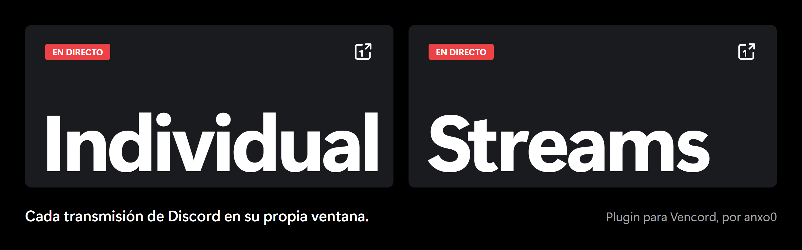

  

  <a href="https://github.com/anxo0/IndividualStreams/releases/latest"><b>⬇️ Descargar el instalador</b></a>
  &nbsp;·&nbsp;
  <a href="https://github.com/anxo0/IndividualStreams/releases/latest">Novedades</a>

Plugin para [Vencord](https://vencord.dev) que abre cada transmisión de Discord en su propia ventana, para poner una en cada pantalla.

Discord solo deja sacar todas las transmisiones juntas en una misma ventana. Con este plugin puedes tener, por ejemplo, la de un amigo en grande en una pantalla y la de otro en la otra.

## Qué añade

- **Botón "Abrir individual"** en la barra de controles, al lado de "Abrir en ventana", con el mismo icono pero con un 1.
- **"Abrir individual"** en el menú de clic derecho de una transmisión o de quien está transmitiendo.
- En la ventana individual: **control de volumen** y **pantalla completa**.

Puedes abrir tantas transmisiones individuales como quieras. Al cerrar una ventana, la transmisión vuelve a la llamada.

## Instalación (Windows)

1. Entra en la **[última versión](https://github.com/anxo0/IndividualStreams/releases/latest)** y descarga `IndividualStreams-Installer-v….exe`.
2. Ábrelo y pulsa Instalar. Si Windows avisa de que es una aplicación desconocida, pulsa "Más información" y "Ejecutar de todas formas".

El instalador cierra Discord, pone Vencord con el plugin y lo vuelve a abrir. No se instala nada en Windows: los archivos van a la carpeta normal de Vencord. Sirve aunque ya tengas Vencord: tus ajustes y plugins se conservan.

Para dejar de usarlo, desactívalo en Ajustes, Vencord, Plugins, como cualquier otro. Para volver al Vencord oficial, ejecuta su instalador.

## Actualizaciones

Se actualiza solo: el actualizador de Vencord comprueba este repositorio al abrir Discord y descarga las versiones nuevas.

También va a la par del Vencord oficial: cada día se comprueba si Vencord ha cambiado y, si es así, se publica una versión nueva con el mismo plugin y el Vencord más reciente.

Si algún día deja de funcionar, vuelve a ejecutar el instalador.

## Uso

Dentro de una llamada, ponte a ver una transmisión y pulsa el botón con el 1 de la barra de controles, o haz clic derecho sobre ella y elige "Abrir individual". Repite con cada transmisión y arrastra cada ventana a la pantalla que quieras.

## A tener en cuenta

- Si ejecutas el instalador oficial de Vencord, sustituirá a este y el plugin desaparecerá. Para recuperarlo, vuelve a ejecutar el de IndividualStreams.
- Los plugins de terceros no los revisa el equipo de Vencord. Úsalo bajo tu responsabilidad.

## Autor

Hecho por **anxo0**.
 

## Licencia

Software libre bajo la licencia [GPL-3.0](LICENSE): puedes usarlo, modificarlo y compartirlo, siempre que lo que compartas mantenga esta licencia y su código fuente.
